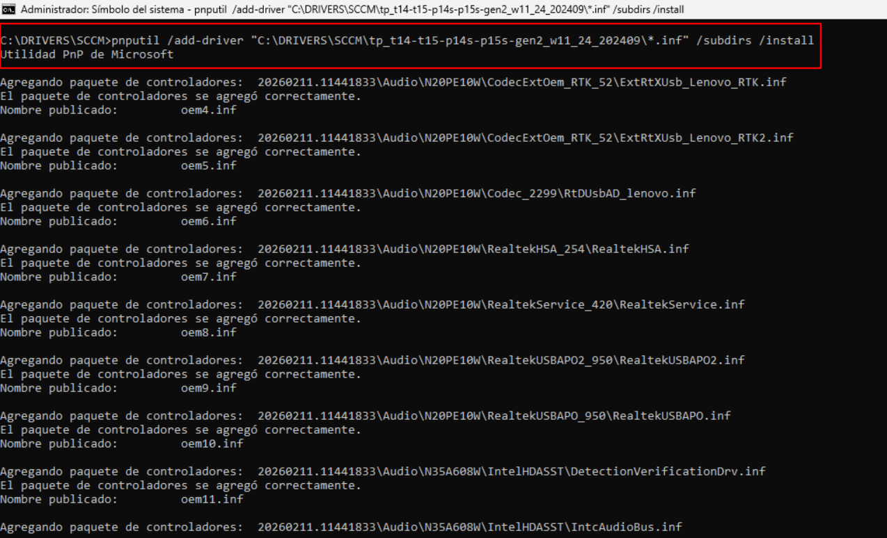
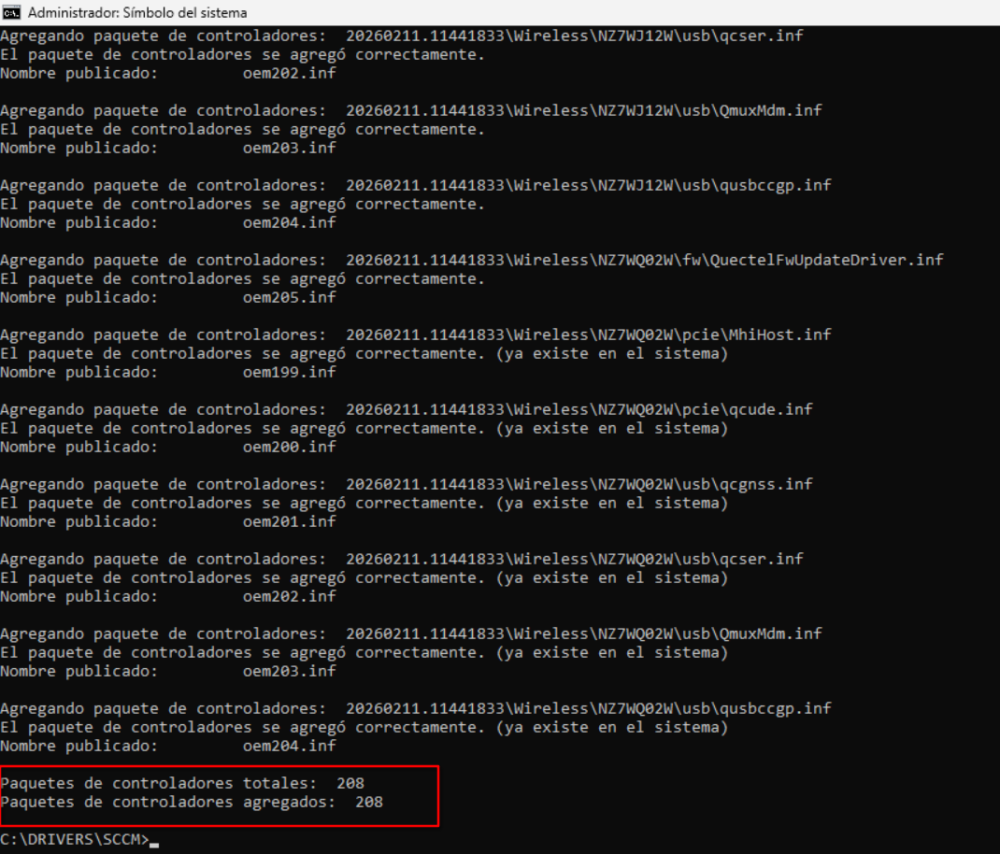

# Captura y Despliegue de Imágenes Windows 11 (.wim)

Procedimiento estandarizado para preparar, generalizar y capturar una imagen de Windows con **Sysprep** y **DISM**, orientado al aprovisionamiento masivo de equipos corporativos.

> [!NOTE]
> Este procedimiento **no genera una ISO**. El resultado final es un archivo **`.wim`** con el sistema ya preparado y generalizado.

---

## Resumen

| | |
|---|---|
| **Objetivo** | Entregar equipos con una configuración idéntica, lista para usar |
| **Herramientas** | Modo Auditoría, Sysprep, DISM, PnPUtil |
| **Resultado** | Imagen `.wim` reutilizable en múltiples equipos |
| **Beneficio** | Menos tiempo de alistamiento y menos errores manuales |

**Flujo general:**
`Modo Auditoría` → `Limpieza` → `Sysprep` → `Captura con DISM` → `Despliegue` → `Drivers`

---

## Documentación

| Documento | Contenido |
|---|---|
| **README.md** (este archivo) | Requisitos previos, estrategia de drivers y descarga offline |
| [`docs/README-02.md`](docs/README-02.md) | Guía paso a paso: auditoría, limpieza, generalización y captura |

> Se recomienda leer este documento antes de pasar a la guía de ejecución.

---

## Requisitos críticos

Dos condiciones evitan fallos en Sysprep y una imagen defectuosa:

**1. Instalar todo el software en `C:\Program Files`**
Evite los instaladores *User Setup* (por ejemplo, Visual Studio Code en su modo por defecto): instalan en `%LocalAppData%`, solo para el usuario actual, y pueden hacer fallar Sysprep. Use siempre el instalador *System* (para todos los usuarios).

**2. Evitar bloqueos por aplicaciones de la Microsoft Store**
Los paquetes AppX instalados o actualizados durante la auditoría pueden impedir que Sysprep finalice. La purga se explica en [`docs/README-02.md`](docs/README-02.md).

---

## Hardware y drivers

| | Equipo físico (recomendado) | Máquina virtual (alternativa) |
|---|---|---|
| **Drivers** | Incluidos desde el fabricante | Ninguno (sistema limpio) |
| **Tamaño del `.wim`** | Controlado | Crece si se inyectan drivers en masa |
| **Alistamiento final** | Más rápido | Requiere instalar drivers en destino |

- **Físico:** al ejecutar la herramienta del fabricante (por ejemplo *Lenovo System Update*) sobre un equipo representativo, los controladores quedan en el *Driver Store* y viajan dentro del `.wim`.
- **Virtual:** no inyecte drivers de varias marcas en la VM; infla la imagen y reduce su estabilidad. Resuelva los drivers **fuera de la imagen**, con el paquete corporativo del fabricante.

---

## Drivers Lenovo offline (paquete SCCM)

Cuando la imagen se creó en un entorno limpio o virtual, los drivers se instalan después con el paquete oficial de Lenovo.

### 1. Descargar el paquete

En el portal de soporte de Lenovo, busque por modelo o número de serie, abra la categoría **Gestión de Empresas** y descargue el paquete que coincida con su versión de Windows (por ejemplo, *SCCM Package for Windows 11 Version 25H2*).

<table>
  <tr>
    <td align="center"><br><sub>Categoría Empresas</sub></td>
    <td align="center"><br><sub>Descarga del paquete SCCM</sub></td>
  </tr>
</table>

### 2. Extraer los controladores

Ejecute el `.exe` en una estación de trabajo técnica. La carpeta resultante ocupa entre 3 y 5 GB, con todos los archivos `.inf`.

<table>
  <tr>
    <td align="center"><br><sub>Extracción del instalador</sub></td>
    <td align="center"><br><sub>Estructura extraída</sub></td>
  </tr>
</table>

### 3. Instalar en el equipo destino

Copie la carpeta (`DriversLenovo`) a un USB o disco externo junto al `.wim`, **fuera de la imagen**. Con la imagen ya aplicada, abra **CMD como administrador** y ejecute:

```cmd
pnputil /add-driver "E:\DriversLenovo\*.inf" /subdirs /install
```

> Reemplace `E:` por la letra que Windows asigne a su unidad externa.

| Parámetro | Función |
|---|---|
| `/subdirs` | Incluye todas las subcarpetas |
| `/install` | Instala los drivers en los dispositivos detectados |

<table>
  <tr>
    <td align="center"><br><sub>Ejecución del comando</sub></td>
    <td align="center"><br><sub>Instalación finalizada</sub></td>
  </tr>
</table>

---

**Siguiente paso:** [`docs/README-02.md`](docs/README-02.md)