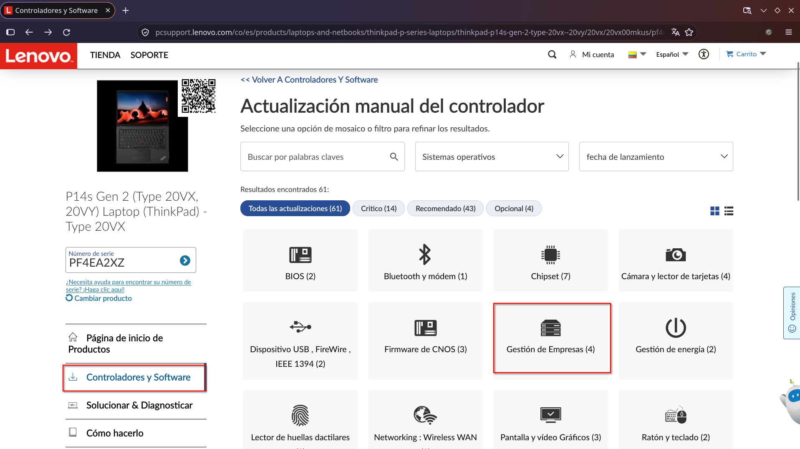
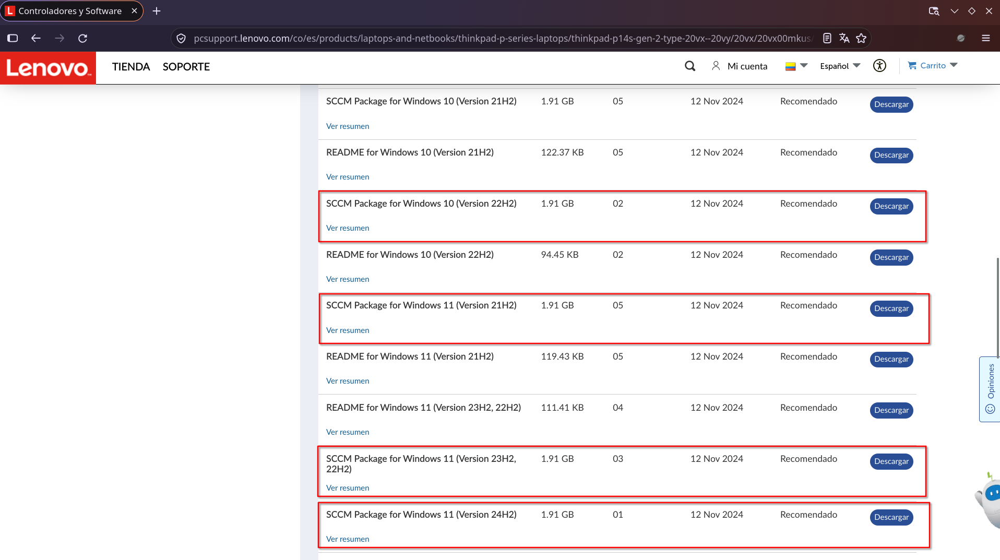
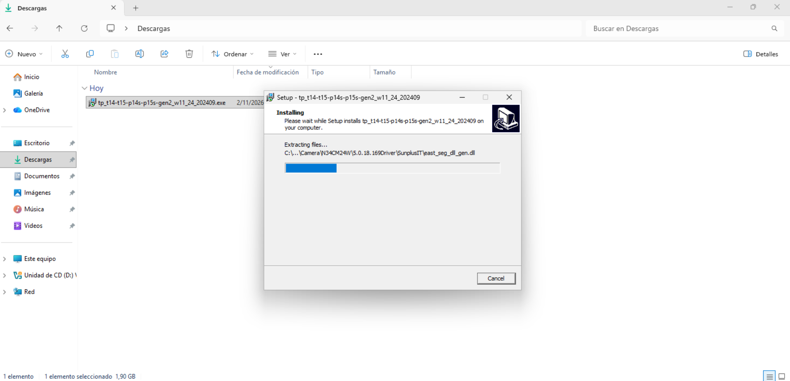
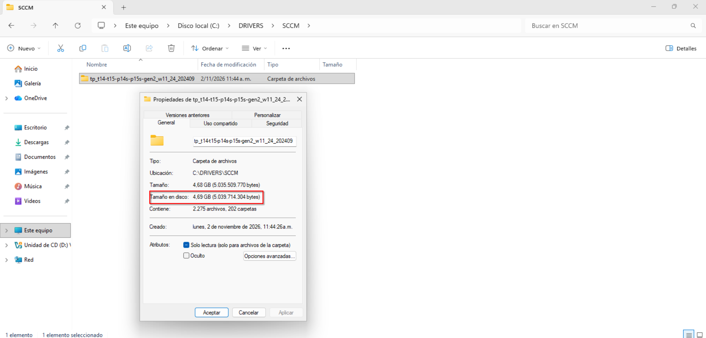

# Documentación Técnica: Despliegue y Captura de Imágenes Windows (.wim)

Índice de procedimientos operativos estándar para la preparación, generalización, limpieza y captura de imágenes del sistema operativo Windows con fines de aprovisionamiento masivo corporativo.

> **Aclaración técnica:** Este procedimiento no genera un archivo ejecutable `.iso`. El entregable final es una partición generalizada encapsulada en un archivo **`.wim`**.

---

## Índice de Contenidos

1. [Alcance y Arquitectura de Documentación](#alcance-y-arquitectura-de-documentación)
2. [Requisitos Críticos en Modo Auditoría](#requisitos-criticos-en-modo-auditoria)
3. [Estrategia de Hardware y Controladores (Drivers)](#estrategia-de-hardware-y-controladores-drivers)
4. [Procedimiento Offline para Equipos Lenovo (Paquetes SCCM)](#procedimiento-offline-para-equipos-lenovo-paquetes-sccm)

---

## Alcance y Arquitectura de Documentación

El repositorio se divide en dos fases operativas para mantener una lectura limpia y estructurada:

| Documento | Enfoque Operativo |
|---|---|
| **Este documento (`README.md`)** | Requisitos previos, consideraciones de hardware/drivers y estrategia de descarga offline. |
| [`docs/README-02.md`](docs/README-02.md) | Guía paso a paso de ejecución: Modo auditoría, rutinas de limpieza, generalización y captura con DISM. |

*Se recomienda leer este documento completo antes de iniciar la ejecución práctica en `docs/README-02.md`.*

---

## Requisitos Críticos en Modo Auditoría

Para evitar fallos de compilación en Sysprep o la corrupción del paquete final, se deben cumplir estrictamente dos condiciones desde el primer arranque:

### 1. Ruta de Instalación Exclusiva en `C:\`
* Todo el software corporativo debe instalarse de forma nativa en la unidad del sistema (`C:\Program Files` o `C:\Archivos de Programa`).
* **Restricción de instaladores:** Quedan totalmente prohibidos los instaladores de usuario (ej. Visual Studio Code con configuración *User Setup* que apunta a `%LocalAppData%`). Estos directorios se eliminan durante la generalización y romperán la imagen.

### 2. Mitigación de Bloqueos por Paquetes AppX
* Las aplicaciones preinstaladas por la Microsoft Store bloquean el cierre de Sysprep. 
* El procedimiento de purga y detención de servicios en segundo plano está documentado paso a paso en [`docs/README-02.md`](docs/README-02.md).

---

## Estrategia de Hardware y Controladores (Drivers)

### Elección del Entorno de Creación

| Variable operativa | Entorno Físico (Recomendado) | Entorno Virtual (Alternativo) |
|---|---|---|
| **Base de drivers** | Heredada del fabricante (registrada en el *Driver Store*) | Sistema operativo limpio ("virgen", sin drivers) |
| **Tamaño del archivo `.wim`** | Controlado y optimizado | Tiende a incrementarse si se comete el error de inyectar lotes masivos |
| **Tiempo de alistamiento final** | Optimizado (drivers precargados) | Mayor tiempo de post-instalación en destino |

* **Entornos físicos:** Al preparar la imagen sobre un equipo representativo (ej. Lenovo ThinkPad) ejecutando herramientas oficiales como *Lenovo System Update*, el *Driver Store* (`C:\Windows\System32\DriverStore`) absorbe los controladores necesarios y los traslada automáticamente al archivo `.wim`.
* **Máquinas virtuales:** No intente inyectar paquetes masivos de múltiples marcas dentro de una VM; esto solo infla el peso del archivo `.wim` y compromete la estabilidad. Si se opta por este método, la gestión de drivers debe resolverse de forma externa mediante paquetes corporativos offline en el destino.

---

## Procedimiento Offline para Equipos Lenovo (Paquetes SCCM)

Para minimizar los tiempos de aprovisionamiento en equipos Lenovo preparados en entornos limpios o virtuales, se utilizan los paquetes de despliegue corporativo oficiales:

### 1. Validación y Descarga
* Ingrese al portal de soporte de Lenovo con el modelo o número de serie.
* Diríjase a la categoría **Gestión de Empresas** y descargue el paquete compatible con su versión de sistema operativo (ej. *SCCM Package for Windows 11 Version 25H2*, archivo `.exe`).

<table>
  <tr>
    <td align="center"><br><sub>Categoría Empresas</sub></td>
    <td align="center"><br><sub>Descarga del paquete SCCM</sub></td>
  </tr>
</table>

### 2. Extracción de Controladores
* Ejecute el archivo descargado en una estación de trabajo técnica. 
* El volumen descomprimido aumentará de tamaño (~3 GB a 5 GB) al estructurar todos los archivos con extensión `.inf`.

<table>
  <tr>
    <td align="center"><br><sub>Extracción del instalador</sub></td>
    <td align="center"><br><sub>Estructura de archivos extraída</sub></td>
  </tr>
</table>

### 3. Despliegue e Inyección en Destino
* Copie la carpeta resultante (`DriversLenovo`) en la unidad de almacenamiento externo (USB/HDD) junto al archivo `.wim`, **fuera de la imagen**.
* Una vez aplicada la imagen en el equipo destino, abra **CMD como Administrador** y ejecute la herramienta nativa `PnPUtil`:

```cmd
pnputil /add-driver "E:\DriversLenovo\*.inf" /subdirs /install