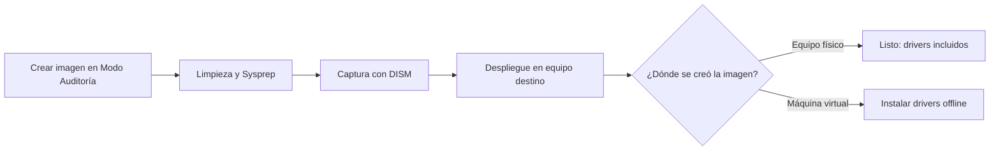

# Captura y Despliegue de Imágenes Windows 11 (.wim)

> [!NOTE]
> Este procedimiento **no genera una ISO**. El resultado final es un archivo **`.wim`** con el sistema ya preparado y generalizado.

## Resumen

| | |
|---|---|
| **Herramientas** | Modo Auditoría, Sysprep, DISM, PnPUtil |
| **Resultado** | Imagen `.wim` reutilizable en múltiples equipos |
| **Beneficio** | Menos tiempo de alistamiento y menos errores manuales |

## Flujo general



## Documentación

| Documento | Contenido |
|---|---|
| **README.md** (este archivo) | Requisitos previos y estrategia de drivers |
| [`docs/README-02.md`](docs/README-02.md) | Guía paso a paso: auditoría, limpieza, generalización y captura |

---

## Requisitos críticos

Dos condiciones evitan fallos en Sysprep y una imagen defectuosa:

- **Instalar todo el software en `C:\Program Files`.**
  Evite los instaladores *User Setup* (por ejemplo, Visual Studio Code en su modo por defecto): instalan en `%LocalAppData%`, solo para el usuario actual, y pueden hacer fallar Sysprep. Use siempre el instalador *System* (para todos los usuarios).

- **Evitar bloqueos por aplicaciones de la Microsoft Store.**
  Los paquetes AppX instalados o actualizados durante la auditoría pueden impedir que Sysprep finalice. La purga se explica en [`docs/README-02.md`](docs/README-02.md).

---

## Drivers: depende de dónde se creó la imagen

| Entorno | ¿Incluye drivers? | Qué hacer |
|---|---|---|
| **Equipo físico** (recomendado) | **Sí.** Se instalan con la herramienta del fabricante (ej. *Lenovo System Update*), quedan en el *Driver Store* y viajan dentro del `.wim`. Sirven para equipos de la misma familia. | Nada adicional |
| **Máquina virtual** | **No.** La imagen queda sin drivers y su instalación en el equipo destino toma más tiempo. | Instalar el paquete offline del fabricante (ver abajo) |

> [!WARNING]
> No inyecte drivers de varios fabricantes dentro de la máquina virtual: infla el `.wim` y compromete su estabilidad.

---

## Paquete offline de drivers Lenovo

**Aplica solo si la imagen se creó en una máquina virtual.** Antes de empezar, valide si el fabricante ofrece un paquete corporativo de despliegue; en Lenovo es el paquete SCCM.

### 1. Descargar el paquete

En el portal de soporte de Lenovo, busque por modelo o número de serie, abra la categoría **Gestión de Empresas** y descargue el paquete que coincida con su versión de Windows (por ejemplo, *SCCM Package for Windows 11 Version 25H2*).

<table>
  <tr>
    <td align="center"><br><sub>Categoría Empresas</sub></td>
    <td align="center"><br><sub>Descarga del paquete SCCM</sub></td>
  </tr>
</table>

### 2. Extraer los controladores

Ejecute el `.exe` en una estación de trabajo técnica. La carpeta resultante ocupa entre 3 y 5 GB, con todos los archivos `.inf`.

<table>
  <tr>
    <td align="center"><br><sub>Extracción del instalador</sub></td>
    <td align="center"><br><sub>Estructura extraída</sub></td>
  </tr>
</table>

### 3. Instalar en el equipo destino

Copie la carpeta (`DriversLenovo`) a un USB o disco externo junto al `.wim`, **fuera de la imagen**. Con la imagen ya aplicada, abra **CMD como administrador** y ejecute:

```cmd
pnputil /add-driver "E:\DriversLenovo\*.inf" /subdirs /install
```

Reemplace `E:` por la letra que Windows asigne a su unidad externa. El parámetro `/subdirs` incluye todas las subcarpetas e `/install` instala los drivers en los dispositivos detectados.

<table>
  <tr>
    <td align="center"><br><sub>Ejecución del comando</sub></td>
    <td align="center"><br><sub>Instalación finalizada</sub></td>
  </tr>
</table>

---

**Siguiente paso:** [`docs/README-02.md`](docs/README-02.md)