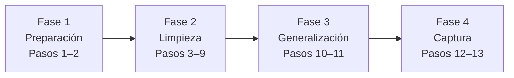

## Flujo del procedimiento



---

## Fase 1 · Preparación

### 1. Ingresar al Modo Auditoría

**Ejecutar en:** pantalla OOBE (configuración inicial de Windows)

Presione `Ctrl + Shift + F3`. El equipo se reinicia e ingresa al Modo Auditoría con la cuenta de administrador integrada.


<table>
  <tr>
    <td align="center"><br><sub>Inicio del Modo Auditoría</sub></td>
    <td align="center"><br><sub>Ingreso al Modo Auditoría</sub></td>
    <td align="center"><br><sub>Escritorio en Modo Auditoría</sub></td>
  </tr>
</table>

### 2. Instalar aplicaciones y configurar Windows

Instale el software corporativo y aplique los ajustes de Windows que requiera su empresa.


> [!IMPORTANT]
[Requisitos críticos](../README.md#requisitos-críticos).


<table>
  <tr>
    <td align="center"><br><sub>Instalación de aplicaciones 01</sub></td>
    <td align="center"><br><sub>Instalación de aplicaciones 02</sub></td>
  </tr>
</table>

---

## Fase 2 · Limpieza **Ejecutar en:** CMD como administrador

### 3. Detener servicios de actualización


```cmd
net stop wuauserv
net stop bits
net stop cryptsvc
```

**Resultado esperado:** Windows confirma que cada servicio se detuvo o que no estaba iniciado.

### 4. Limpiar el almacén de componentes


```cmd
dism /Online /Cleanup-Image /StartComponentCleanup /ResetBase
```

**Resultado esperado:** la operación llega al 100 % y finaliza correctamente.

> [!NOTE]
> `/ResetBase` impide desinstalar las actualizaciones ya instaladas.

### 5. Limpiar la caché de Windows Update


```cmd
rd /s /q C:\Windows\SoftwareDistribution\Download
mkdir C:\Windows\SoftwareDistribution\Download
```

Se eliminan los archivos descargados, no el historial de actualizaciones instaladas.

### 6. Ejecutar la limpieza de disco


```cmd
cleanmgr /sageset:1
cleanmgr /sagerun:1
```

En la ventana de `sageset`, seleccione las categorías a limpiar y confirme. Después, `sagerun` ejecuta la limpieza con esas opciones.

### 7. Eliminar temporales y papelera


```cmd
del /q /f /s "%TEMP%\*"
del /q /f /s "C:\Windows\Temp\*"
rd /s /q C:\$Recycle.Bin
```

### 8. Eliminar registros de eventos


```cmd
for /F "tokens=*" %G in ('wevtutil el') do wevtutil cl "%G"
```


### 9. Eliminar logs previos de Sysprep y DISM


```cmd
del /q /f "C:\Windows\System32\Sysprep\Panther\*.*"
del /q /f "C:\Windows\Logs\DISM\*.*"
```

---

## Fase 3 · Generalización **Ejecutar en:** PowerShell como administrador


### 10. Verificar paquetes AppX


Los paquetes AppX en estado *staged* pueden bloquear Sysprep. Verifique si existe alguno:

```powershell
Get-AppxPackage -AllUsers |
Where-Object {$_.PackageUserInformation -match "Staged"} |
Select-Object Name, PackageFullName
```

Revise también los paquetes provisionados (la lista es completa; retire únicamente los problemáticos):

```powershell
Get-AppxProvisionedPackage -Online |
Select-Object DisplayName, PackageName
```

Si no aparece ningún paquete problemático, continúe con el paso 11. De lo contrario, evalúe su procedencia y dependencias antes de retirarlo:

```powershell
# Paquete instalado
Remove-AppxPackage -Package "NombreCompletoDelPaquete" -AllUsers

# Paquete provisionado
Remove-AppxProvisionedPackage -Online -PackageName "NombreDelPaquete"
```

> [!IMPORTANT]
> Retirar un paquete instalado y retirar su aprovisionamiento son operaciones distintas. Verifique ambas condiciones antes de continuar.


## Fase 4 · Captura **Ejecutar en:** CMD como administrador

### 11. Generalizar con Sysprep


```cmd
C:\Windows\System32\Sysprep\sysprep.exe /generalize /oobe /shutdown
```

**Resultado esperado:** el equipo se apaga automáticamente al finalizar.

> [!CAUTION]
> **No vuelva a iniciar Windows después de este paso.** Arranque directamente desde WinPE; de lo contrario, el sistema entra al OOBE y el proceso debe repetirse.

Si Sysprep falla, el detalle queda en `C:\Windows\System32\Sysprep\Panther\.log`.

---


### 12. Capturar la imagen del sistema **Ejecutar en:** CMD en WinPE


Arranque el equipo desde WinPE o un USB booteable. Identifique las unidades con `diskpart` → `list volume`, ya que las letras pueden diferir de las usadas en Windows.

| Elemento | Unidad usada en esta guía |
|---|---|
| **Origen** | `C:\` — partición de Windows generalizada |
| **Destino** | `D:\` — unidad donde se guarda el WIM |
| **Temporal** | `D:\Scratch` — directorio de trabajo de DISM |

El origen y el destino deben ser particiones distintas, y el destino debe tener espacio suficiente.

```cmd
mkdir D:\Scratch
dism /Capture-Image /ImageFile:D:\install.wim /CaptureDir:C:\ /Name:"Windows Personalizado Rapido" /Description:"Imagen Sysprep optimizada" /Compress:fast /ScratchDir:D:\Scratch
```

| Parámetro | Descripción |
|---|---|
| `/Capture-Image` | Inicia la captura de la partición de origen. |
| `/ImageFile` | Ruta y nombre del archivo WIM. |
| `/CaptureDir` | Partición de Windows que se captura. |
| `/Name` | Nombre de la imagen. |
| `/Description` | Descripción de la imagen. |
| `/Compress:fast` | Compresión rápida; reduce el tiempo frente a `max`. |
| `/ScratchDir` | Directorio temporal utilizado por DISM. |

> [!IMPORTANT]
> La duración depende del volumen de información, del software instalado y del rendimiento del almacenamiento. Espere hasta que DISM llegue al **100 %**, muestre el mensaje de finalización exitosa y libere la terminal. No interrumpa el proceso ni apague el equipo.

<table>
  <tr>
    <td align="center"><br><sub>Captura en ejecución</sub></td>
    <td align="center"><br><sub>Captura finalizada correctamente</sub></td>
  </tr>
</table>


El archivo `install.wim` queda disponible para su implementación en los equipos de destino.

**Siguiente paso:** [Aplicación de imagen y secuencias de despliegue](README-03.md)
