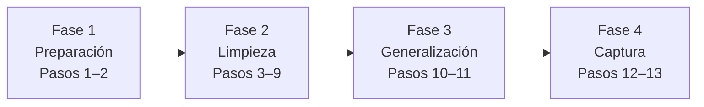

## Flujo del procedimiento



---

## Fase 1 · Preparación

### 1. Modo Auditoría

En la pantalla OOBE, presione `Ctrl + Shift + F3`. El equipo reinicia y entra en Modo Auditoría. Cierre la ventana de Sysprep que aparece.

<p align="center">
  
  
  
</p>

### 2. Instalación de aplicaciones

Instale el software corporativo y aplique los ajustes de Windows que requiera su empresa.

> [!IMPORTANT]
> Instale todo en `C:\Program Files` con instaladores para todos los usuarios (*System*), no *User Setup*. Ver [Requisitos críticos](../README.md#requisitos-críticos).

<p align="center">
  
  
</p>

---

## Fase 2 · Limpieza

### 3. Detener servicios de actualización

**Consola:** CMD como administrador

```cmd
net stop wuauserv
net stop bits
net stop cryptsvc
```

### 4. Limpiar el almacén de componentes

**Consola:** CMD como administrador

```cmd
dism /Online /Cleanup-Image /StartComponentCleanup /ResetBase
```

El proceso debe llegar al 100 %. `/ResetBase` impide desinstalar las actualizaciones ya instaladas.

### 5. Limpiar la caché de Windows Update

**Consola:** CMD como administrador

```cmd
rd /s /q C:\Windows\SoftwareDistribution\Download
mkdir C:\Windows\SoftwareDistribution\Download
```

### 6. Limpiar el disco

**Consola:** CMD como administrador

```cmd
cleanmgr /sageset:1
cleanmgr /sagerun:1
```

En la ventana de `sageset`, marque todas las categorías y acepte.

### 7. Eliminar temporales y papelera

**Consola:** CMD como administrador

```cmd
del /q /f /s "%TEMP%\*"
del /q /f /s "C:\Windows\Temp\*"
rd /s /q C:\$Recycle.Bin
```

### 8. Eliminar registros de eventos

**Consola:** CMD como administrador

```cmd
for /F "tokens=*" %G in ('wevtutil el') do wevtutil cl "%G"
```

> [!WARNING]
> Este paso y el siguiente eliminan registros que pueden ser necesarios para auditoría. Ejecútelos solo con autorización y conforme a la política de conservación de la organización.

### 9. Eliminar logs de Sysprep y DISM

**Consola:** CMD como administrador

```cmd
del /q /f "C:\Windows\System32\Sysprep\Panther\*.*"
del /q /f "C:\Windows\Logs\DISM\*.*"
```

---

## Fase 3 · Generalización

### 10. Verificar paquetes AppX

**Consola:** PowerShell como administrador

Verifique si hay paquetes en estado *staged* o provisionados:

```powershell
Get-AppxPackage -AllUsers |
Where-Object {$_.PackageUserInformation -match "Staged"} |
Select-Object Name, PackageFullName

Get-AppxProvisionedPackage -Online |
Select-Object DisplayName, PackageName
```

Si no aparece ninguno que cause conflicto, continúe con el paso 11. Si aparece alguno, retírelo (instalado y provisionado son operaciones distintas):

```powershell
Remove-AppxPackage -Package "NombreCompletoDelPaquete" -AllUsers
Remove-AppxProvisionedPackage -Online -PackageName "NombreDelPaquete"
```

### 11. Generalizar con Sysprep

**Consola:** CMD como administrador

```cmd
C:\Windows\System32\Sysprep\sysprep.exe /generalize /oobe /shutdown
```

El equipo se apaga al finalizar. Si Sysprep falla, revise `C:\Windows\System32\Sysprep\Panther\setuperr.log`.

> [!CAUTION]
> **No inicie Windows después de este paso.** Si arranca normalmente, el sistema entra al OOBE y todo el proceso debe repetirse.

---

## Fase 4 · Captura

### 12. Capturar la imagen

**Consola:** CMD en WinPE

Arranque desde WinPE o un USB booteable. Verifique las letras de unidad con `diskpart` → `list volume` y ajuste los comandos: aquí `C:` es Windows y `D:` es la unidad externa.

```cmd
mkdir D:\Scratch
dism /Capture-Image /ImageFile:D:\install.wim /CaptureDir:C:\ /Name:"Windows Personalizado Rapido" /Description:"Imagen Sysprep optimizada" /Compress:fast /ScratchDir:D:\Scratch
```

> [!IMPORTANT]
> Espere a que DISM llegue al **100 %** y muestre el mensaje de finalización. No interrumpa el proceso ni apague el equipo.

<p align="center">
  
  
</p>

### 13. Verificar la imagen (opcional)

**Consola:** CMD en WinPE

```cmd
dism /Get-WimInfo /WimFile:D:\install.wim
```

Debe listarse el índice 1 con el nombre definido en la captura.

---

**Siguiente paso:** [Aplicación de imagen y secuencias de despliegue](README-03.md)