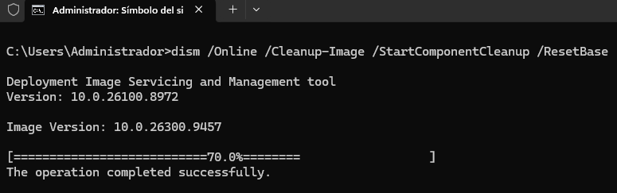

## Fase 1 · Preparación

### 01. Ingresar al modo auditoría

**Entorno:** Windows OOBE

En la pantalla inicial de configuración de Windows, presione `Ctrl + Shift + F3`.

El equipo se reiniciará e ingresará al modo auditoría mediante la cuenta de administrador integrada.

Cierre la ventana de Sysprep que aparece automáticamente. Se utilizará posteriormente.

<p align="center">
  
  
  
</p>

---

### 02. Instalar aplicaciones y configurar Windows

**Entorno:** Modo auditoría

Instale las aplicaciones corporativas y aplique las configuraciones requeridas para el entorno de destino.

Priorice instalaciones para todos los usuarios del equipo. Verifique que las aplicaciones queden instaladas en las rutas correspondientes:

- `C:\Program Files`
- `C:\Program Files (x86)`

Evite instaladores de tipo *User Setup* cuando el objetivo sea disponer del software para todos los usuarios.

<p align="center">
  
  
</p>

---

## Fase 2 · Limpieza

### 03. Detener servicios de actualización

Detenga los servicios relacionados con Windows Update antes de realizar las tareas de mantenimiento.

```cmd
net stop wuauserv
net stop bits
net stop cryptsvc
```

> **Resultado esperado:** Windows confirma que los servicios se han detenido o que no se encuentran iniciados.

---

### 04. Limpiar el almacén de componentes

Ejecute DISM para eliminar componentes reemplazados y reducir el espacio ocupado por el almacén de componentes de Windows.

```cmd
dism /Online /Cleanup-Image /StartComponentCleanup /ResetBase
```

> **Resultado esperado:** la operación alcanza el 100 % y finaliza correctamente.

> **Consideración:** `/ResetBase` impide desinstalar las actualizaciones existentes mediante los mecanismos habituales de Windows.

<p align="center">
  
</p>

---

### 05. Limpiar la caché de Windows Update

Elimine los archivos descargados por Windows Update y reconstruya el directorio de caché.

```cmd
rd /s /q C:\Windows\SoftwareDistribution\Download
mkdir C:\Windows\SoftwareDistribution\Download
```

Esta operación elimina los archivos descargados, no el historial de actualizaciones instalado.

---

### 06. Ejecutar limpieza de disco

Configure y ejecute la herramienta de limpieza de disco de Windows.

```cmd
cleanmgr /sageset:1
cleanmgr /sagerun:1
```

En la ventana de configuración (`sageset`), seleccione las categorías de limpieza correspondientes y confirme. Posteriormente, `sagerun` ejecutará la limpieza con las opciones seleccionadas.

---

### 07. Eliminar archivos temporales y papelera

Elimine los archivos temporales del usuario y del sistema, así como el contenido de la papelera de reciclaje.

```cmd
del /q /f /s "%TEMP%\*"
del /q /f /s "C:\Windows\Temp\*"
rd /s /q C:\$Recycle.Bin
```

Los archivos que estén en uso o protegidos por Windows pueden permanecer en el sistema.

---

### 08. Limpiar registros de eventos

La siguiente operación permite eliminar los registros de eventos existentes en Windows.

```cmd
for /F "tokens=*" %G in ('wevtutil el') do wevtutil cl "%G"
```

> [!WARNING]
> Esta operación elimina información histórica que puede ser necesaria para auditorías, investigaciones de incidentes y diagnóstico. Ejecútela únicamente con autorización y de acuerdo con la política de conservación de registros de la organización.

> **Nota:** en archivos `.bat`, sustituya `%G` por `%%G`.

---

### 09. Limpiar registros anteriores de Sysprep y DISM

Elimine los registros de ejecuciones anteriores para facilitar la identificación de errores durante el siguiente proceso.

```cmd
del /q /f "C:\Windows\System32\Sysprep\Panther\*.*"
del /q /f "C:\Windows\Logs\DISM\*.*"
```

> **Consideración:** realice esta operación únicamente después de conservar los registros que puedan ser necesarios para auditoría o diagnóstico.

---

## Fase 3 · Generalización

### 10. Verificar paquetes AppX

Antes de ejecutar Sysprep, compruebe si existen paquetes AppX en estado `Staged`, ya que determinadas aplicaciones instaladas o actualizadas mediante Microsoft Store pueden generar conflictos durante la generalización.

**PowerShell:**

```powershell
Get-AppxPackage -AllUsers |
Where-Object {$_.PackageUserInformation -match "Staged"} |
Select-Object Name, PackageFullName
```

Compruebe también los paquetes provisionados:

```powershell
Get-AppxProvisionedPackage -Online |
Select-Object DisplayName, PackageName
```

Si se identifican paquetes problemáticos, evalúe su procedencia y dependencias antes de eliminarlos.

Para retirar un paquete instalado:

```powershell
Remove-AppxPackage -Package "NombreCompletoDelPaquete" -AllUsers
```

Para retirar un paquete provisionado:

```powershell
Remove-AppxProvisionedPackage -Online -PackageName "NombreDelPaquete"
```

> [!IMPORTANT]
> La eliminación de un paquete instalado y la eliminación de su aprovisionamiento son operaciones diferentes. Verifique ambas condiciones antes de continuar.

---

### 11. Generalizar con Sysprep

Ejecute Sysprep para preparar la instalación de Windows para su implementación en otros equipos.

```cmd
C:\Windows\System32\Sysprep\sysprep.exe /generalize /oobe /shutdown
```

> **Resultado esperado:** el equipo se apaga automáticamente cuando finaliza la generalización.

> [!CAUTION]
> **No vuelva a iniciar Windows después de este paso.** Arranque directamente desde WinPE para continuar con la captura y evitar iniciar el OOBE de la instalación que se va a capturar.

En caso de error, consulte el registro:

`C:\Windows\System32\Sysprep\Panther\setuperr.log`

---

## Fase 4 · Captura

### 12. Capturar la imagen del sistema

**Entorno:** WinPE

Arranque el equipo desde WinPE o un medio USB booteable.

Antes de ejecutar DISM, identifique las unidades disponibles mediante `diskpart` → `list volume`. Las letras pueden variar respecto a las asignadas durante la instalación de Windows.

En este procedimiento se utiliza:

- **Origen:** `C:\` — partición de Windows generalizada.
- **Destino:** `D:\` — unidad donde se almacenará el archivo WIM.
- **Temporal:** `D:\Scratch` — directorio de trabajo de DISM.

Asegúrese de que las particiones de origen y destino sean diferentes y que la unidad de destino disponga de espacio suficiente.

**CMD en WinPE:**

```cmd
mkdir D:\Scratch

dism /Capture-Image /ImageFile:D:\install.wim /CaptureDir:C:\ /Name:"Windows Personalizado Rapido" /Description:"Imagen Sysprep optimizada" /Compress:fast /ScratchDir:D:\Scratch
```

**Referencia de parámetros:**

| Parámetro | Descripción |
|:---:|---|
| `/Capture-Image` | Inicia la captura de la partición de origen. |
| `/ImageFile` | Define la ruta y el nombre del archivo WIM. |
| `/CaptureDir` | Especifica la partición de Windows que se capturará. |
| `/Name` | Asigna el nombre de la imagen. |
| `/Description` | Define la descripción de la imagen. |
| `/Compress:fast` | Utiliza compresión rápida para reducir el tiempo de procesamiento frente a `max`. |
| `/ScratchDir` | Define el directorio temporal utilizado por DISM. |

> [!IMPORTANT]
> **Tiempo de captura:** la duración depende del volumen de información, el software instalado y el rendimiento del almacenamiento. No es un proceso inmediato. Espere hasta que DISM alcance el **100 %**, muestre el mensaje de finalización exitosa y libere la terminal. No interrumpa el proceso ni apague el equipo durante su ejecución.

<p align="center">
  
  <br>
  <sub>Figura 07. Ejecución de la captura mediante DISM.</sub>
</p>

<p align="center">
  
  <br>
  <sub>Figura 08. Captura finalizada correctamente.</sub>
</p>

---

### 13. Comprobar el archivo generado (opcional)

Una vez finalizada la operación, puede comprobar la existencia y el tamaño del archivo WIM en la unidad de destino.

```cmd
dir D:\install.wim
```

**Criterios de comprobación:**

- **Archivo inexistente:** la captura no generó el archivo en la ruta especificada.
- **Tamaño de 0 bytes:** la captura no produjo una imagen válida.
- **Tamaño superior a 0 bytes:** existe información almacenada; esto no garantiza por sí solo la integridad del WIM.

Para una comprobación adicional de su estructura, puede consultar sus metadatos:

```cmd
dism /Get-WimInfo /WimFile:D:\install.wim
```

---

## Finalización

Con la captura completada, el archivo `install.wim` queda disponible para su posterior implementación en los equipos de destino mediante el procedimiento de despliegue correspondiente.

---

**Siguiente paso:** [Aplicación de imagen y secuencias de despliegue](README-03.md)
