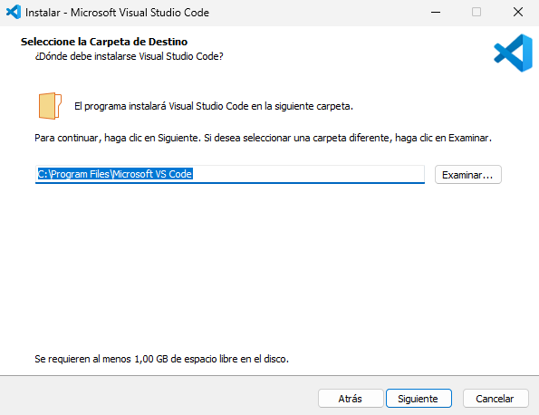
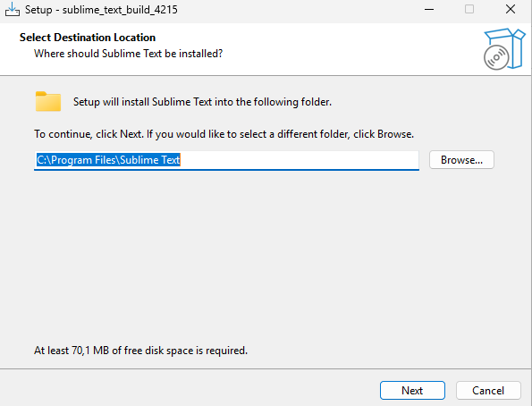
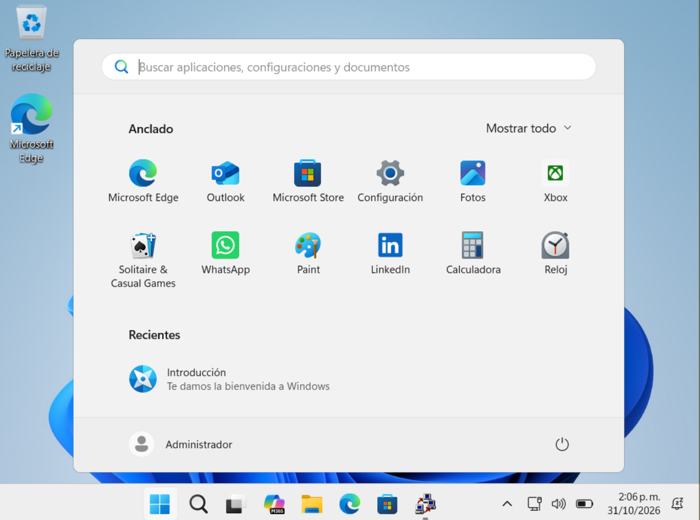
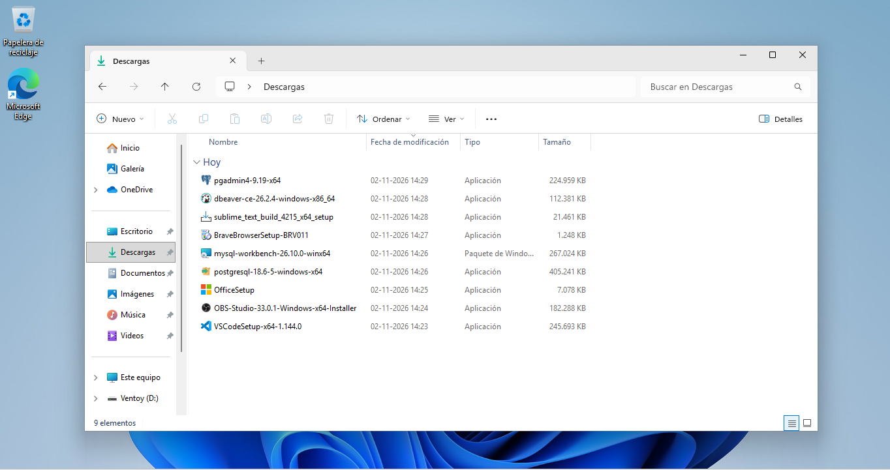

## 1. Modo Auditoría

En la pantalla OOBE, presionar `Ctrl + Shift + F3`. El equipo reinicia y entra en modo auditoría con la cuenta de administrador integrada.


---

## 2. Instalación de aplicaciones

Instalar el software corporativo requerido.

**Condiciones obligatorias:**

- Todas las aplicaciones deben instalarse en la unidad `C:\` (`Program Files`). De lo contrario, Sysprep falla al generalizar.
- Usar instaladores de sistema (*system-wide*). Los instaladores de usuario (*User Setup*, por ejemplo el de Visual Studio Code por defecto) instalan en `%LocalAppData%` y se pierden al generalizar.






---

## 3. Detener servicios de actualización

**Consola: CMD como administrador**

```cmd
net stop wuauserv
net stop bits
net stop cryptsvc
```

Resultado esperado: la consola confirma que cada servicio se detuvo.


---

## 4. Limpieza del almacén de componentes

**Consola: CMD como administrador**

```cmd
dism /Online /Cleanup-Image /StartComponentCleanup /ResetBase
```

Resultado esperado: el comando llega al 100% y finaliza con éxito.

`/ResetBase` impide desinstalar las actualizaciones ya instaladas.


---

## 5. Limpieza de caché de Windows Update

**Consola: CMD como administrador**

```cmd
rd /s /q C:\Windows\SoftwareDistribution\Download
mkdir C:\Windows\SoftwareDistribution\Download
```

---

## 6. Limpieza de disco

**Consola: CMD como administrador**

```cmd
cleanmgr /sageset:1
cleanmgr /sagerun:1
```

En `sageset` se abre una ventana: marcar todas las categorías y aceptar.

---

## 7. Eliminación de temporales y papelera

**Consola: CMD como administrador**

```cmd
del /q /f /s "%TEMP%\*"
del /q /f /s "C:\Windows\Temp\*"
rd /s /q C:\$Recycle.Bin
```

---

## 8. Eliminación de registros de eventos

**Consola: CMD como administrador**

```cmd
for /F "tokens=*" %G in ('wevtutil el') do wevtutil cl "%G"
```

En un archivo `.bat`, usar `%%G`.

---

## 9. Eliminación de logs de Sysprep y DISM

**Consola: CMD como administrador**

```cmd
del /q /f "C:\Windows\System32\Sysprep\Panther\*.*"
del /q /f "C:\Windows\Logs\DISM\*.*"
```

---

## 10. Verificación de paquetes AppX

**Consola: PowerShell como administrador**

Los paquetes AppX en estado *staged* bloquean Sysprep. Verificar:

```powershell
Get-AppxPackage -AllUsers | Where-Object {$_.PackageUserInformation -match "Staged"} | Select Name,PackageFullName
```

Si aparece algún paquete, eliminarlo:

```powershell
Remove-AppxPackage -Package "NombreCompletoDelPaquete" -AllUsers
```



---

## 11. Generalización con Sysprep

**Consola: CMD como administrador**

```cmd
C:\Windows\System32\Sysprep\sysprep.exe /generalize /oobe /shutdown
```

Resultado esperado: el equipo se apaga al finalizar.

**No iniciar Windows después de este paso.** Si arranca normalmente, el sistema entra al OOBE y el proceso debe repetirse.



---

## 12. Captura de la imagen

**Consola: CMD en WinPE**

Arrancar desde WinPE o USB booteable. Verificar las letras de unidad con `diskpart` → `list volume`; en WinPE pueden diferir de las usadas aquí.

```cmd
mkdir E:\Scratch
dism /Capture-Image /ImageFile:E:\install.wim /CaptureDir:C:\ /Name:"Windows Personalizado Rapido" /Description:"Imagen Sysprep optimizada" /Compress:fast /ScratchDir:E:\Scratch
```

| Parámetro | Función |
|---|---|
| `/Capture-Image` | Crea el WIM a partir de la partición origen. |
| `/ImageFile:E:\install.wim` | Ruta y nombre del WIM generado. |
| `/CaptureDir:C:\` | Partición generalizada a capturar. |
| `/Compress:fast` | Compresión rápida; reduce el tiempo frente a `max`. |
| `/ScratchDir:E:\Scratch` | Directorio temporal en disco, evita uso excesivo de RAM. |

---

## 13. Verificación de la imagen

**Consola: CMD en WinPE**

```cmd
dism /Get-WimInfo /WimFile:E:\install.wim
```

Resultado esperado: se lista el índice 1 con el nombre y la descripción definidos en la captura.
