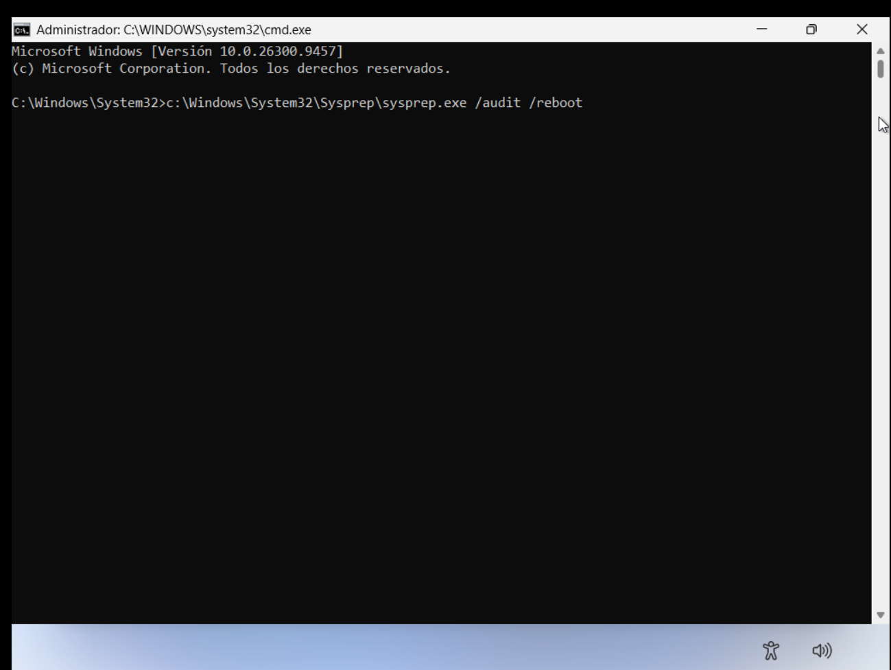
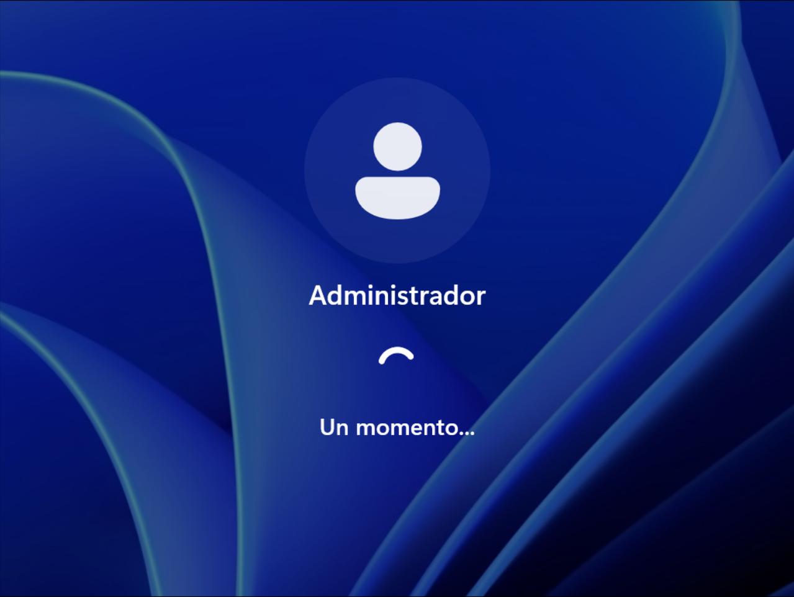
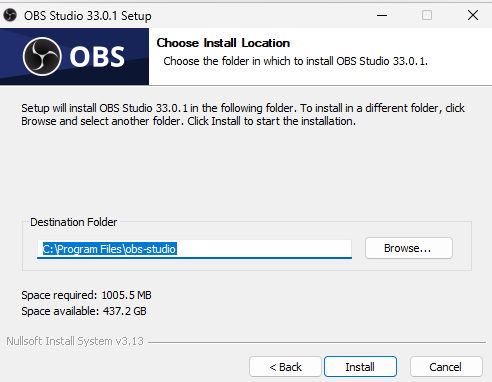
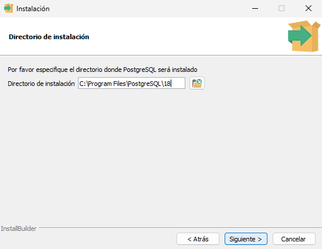

# Guía de ejecución

---

## Fase 1 · Preparación

### 1. Modo Auditoría

En la pantalla OOBE, presione `Ctrl + Shift + F3`. El equipo reinicia y entra en modo auditoría con la cuenta de administrador integrada. Cierre la ventana de Sysprep que aparece al ingresar; se usará más adelante.

<p align="center">
  
  
  
</p>

### 2. Instalación de aplicaciones

Instale el software corporativo y aplique los ajustes de Windows que requiera su empresa. Verifique que cada aplicación quede en `C:\Program Files` o `C:\Program Files (x86)`.

<p align="center">
  
  
</p>

---

## Fase 2 · Limpieza

### 3. Detener servicios de actualización

**Consola:** CMD como administrador

```cmd
net stop wuauserv
net stop bits
net stop cryptsvc
```

> **Resultado esperado:** la consola confirma que cada servicio se detuvo.

### 4. Limpiar el almacén de componentes

**Consola:** CMD como administrador

```cmd
dism /Online /Cleanup-Image /StartComponentCleanup /ResetBase
```

> **Resultado esperado:** el comando llega al 100 % y finaliza con éxito.
> `/ResetBase` impide desinstalar las actualizaciones ya instaladas.

### 5. Limpiar la caché de Windows Update

**Consola:** CMD como administrador

```cmd
rd /s /q C:\Windows\SoftwareDistribution\Download
mkdir C:\Windows\SoftwareDistribution\Download
```

### 6. Limpiar el disco

**Consola:** CMD como administrador

```cmd
cleanmgr /sageset:1
cleanmgr /sagerun:1
```

> En `sageset` se abre una ventana: marque todas las categorías y acepte.

### 7. Eliminar temporales y papelera

**Consola:** CMD como administrador

```cmd
del /q /f /s "%TEMP%\*"
del /q /f /s "C:\Windows\Temp\*"
rd /s /q C:\$Recycle.Bin
```

### 8. Eliminar registros de eventos

**Consola:** CMD como administrador

```cmd
for /F "tokens=*" %G in ('wevtutil el') do wevtutil cl "%G"
```

> En un archivo `.bat`, use `%%G`.

### 9. Eliminar logs de Sysprep y DISM

**Consola:** CMD como administrador

```cmd
del /q /f "C:\Windows\System32\Sysprep\Panther\*.*"
del /q /f "C:\Windows\Logs\DISM\*.*"
```

---

## Fase 3 · Generalización

### 10. Verificar paquetes AppX

**Consola:** PowerShell como administrador

Verifique que no haya paquetes en estado *staged*:

```powershell
Get-AppxPackage -AllUsers | Where-Object {$_.PackageUserInformation -match "Staged"} | Select Name,PackageFullName
```

Si aparece alguno, elimínelo:

```powershell
Remove-AppxPackage -Package "NombreCompletoDelPaquete" -AllUsers
```

### 11. Generalizar con Sysprep

**Consola:** CMD como administrador

```cmd
C:\Windows\System32\Sysprep\sysprep.exe /generalize /oobe /shutdown
```

> **Resultado esperado:** el equipo se apaga al finalizar.

> [!WARNING]
> **No inicie Windows después de este paso.** Si arranca normalmente, el sistema entra al OOBE y todo el proceso debe repetirse.

> Si Sysprep falla, el detalle queda en `C:\Windows\System32\Sysprep\Panther\setuperr.log`.

---

## Fase 4 · Captura

### 12. Capturar la imagen

**Consola:** CMD en WinPE

Arranque desde WinPE o un USB booteable. Verifique las letras de unidad con `diskpart` → `list volume`; en WinPE pueden diferir de las usadas aquí.

```cmd
mkdir E:\Scratch
dism /Capture-Image /ImageFile:E:\install.wim /CaptureDir:C:\ /Name:"Windows Personalizado Rapido" /Description:"Imagen Sysprep optimizada" /Compress:fast /ScratchDir:E:\Scratch
```

| Parámetro | Función |
|---|---|
| `/Capture-Image` | Crea el WIM a partir de la partición origen |
| `/ImageFile:E:\install.wim` | Ruta y nombre del WIM generado |
| `/CaptureDir:C:\` | Partición generalizada a capturar |
| `/Compress:fast` | Compresión rápida; reduce el tiempo frente a `max` |
| `/ScratchDir:E:\Scratch` | Directorio temporal en disco; evita uso excesivo de RAM |

### 13. Verificar la imagen

**Consola:** CMD en WinPE

```cmd
dism /Get-WimInfo /WimFile:E:\install.wim
```

> **Resultado esperado:** se lista el índice 1 con el nombre y la descripción definidos en la captura.

---

**Resultado final:** `install.wim` listo para desplegarse. Si la imagen se creó en una máquina virtual, instale los drivers como se indica en el [README principal](../README.md).