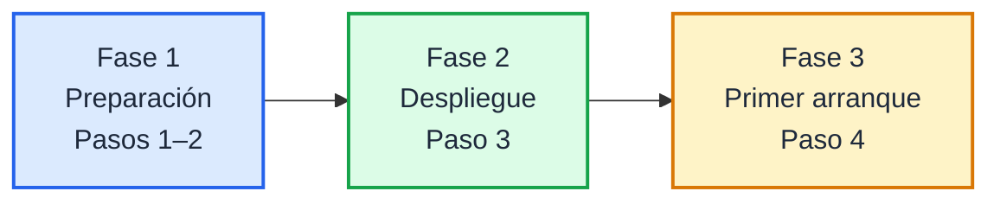
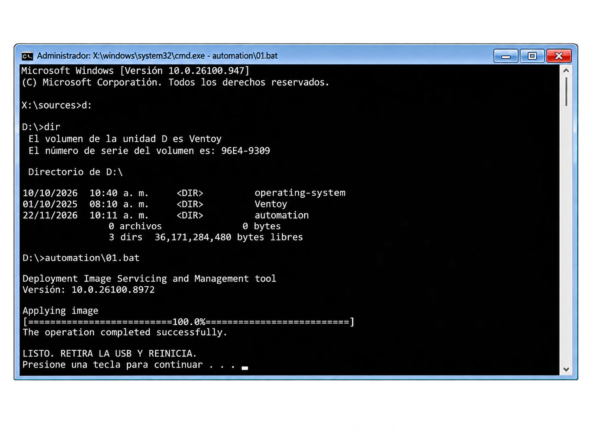

## Flujo del procedimiento



<br>
<br>

---

## Fase 1 · Preparación

### 1. Preparar la USB

Instale [Ventoy](https://www.ventoy.net) en la USB y copie los archivos con la siguiente estructura:

```text
USB (Ventoy)
├── operating-system
│   └── Windows11.iso      # ISO de Windows 11 (arranque)
└── automation
    ├── 01.bat             # Formatea el disco y aplica la imagen
    └── install.wim        # Imagen generada en el README-02
```

La carpeta `automation` debe conservar ese nombre: el script busca allí la imagen en cualquier unidad. La ISO puede ubicarse en cualquier carpeta.

<br>

### 2. Arrancar desde la USB

Inicie el equipo desde la USB y en el menú de Ventoy seleccione la ISO de Windows (modo **wimboot** si se solicita). Cuando cargue el instalador, presione <kbd>Shift</kbd> + <kbd>F10</kbd> para abrir una ventana de **CMD**.

<p align="center">
  
  
</p>

<br>
<br>

---

## Fase 2 · Despliegue

### 3. Ejecutar el script

> [!CAUTION]
> El script **formatea por completo el disco 0**. Úselo únicamente en equipos destinados a ser reinstalados.

```cmd
D:\automation\01.bat
```

Reemplace `D:` por la letra de la USB; si no la conoce, verifíquela con `diskpart` → `list volume`.

El script ejecuta en orden:

1. **Formateo de unidad:** particiona el disco 0 en GPT/UEFI (EFI, MSR y Windows).
2. **Aplicación de imagen:** aplica `install.wim` con DISM.
3. **Bypass de la configuración inicial:** habilita `BypassNRO` en el registro offline para omitir el requisito de red y de cuenta Microsoft.
4. **Arranque UEFI:** registra el cargador de arranque con BCDBoot.

Al finalizar muestra `LISTO. RETIRA LA USB Y REINICIA.` No interrumpa el proceso antes de ese mensaje.

<!-- Imagen o video de la ejecución -->
<p align="center">
  
  
</p>

<br>
<br>

---

## Fase 3 · Primer arranque

### 4. Crear el usuario

Antes de reiniciar, **desconecte el cable Ethernet**; durante todo el primer arranque el equipo debe permanecer **sin red y sin conectarse a ninguna red Wi-Fi**. Con conexión a internet, Windows puede exigir una cuenta Microsoft.

Retire la USB y reinicie. Gracias al bypass, la configuración inicial (OOBE) permite continuar con la opción *No tengo Internet*: cree la cuenta local, que será administradora. Si esa opción no aparece, presione <kbd>Shift</kbd> + <kbd>F10</kbd> y ejecute `start ms-cxh:localonly`.

<br>
<br>

---

**Anterior:** [`docs/README-02.md`](README-02.md) · **Opcional:** [`docs/README-04.md`](README-04.md)