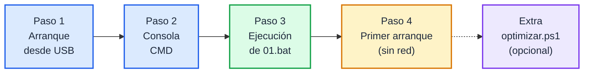

## Flujo del procedimiento



<br>

---

## Requisitos

USB con [Ventoy](https://www.ventoy.net) que contenga:

| Archivo | Ubicación | Función |
|---|---|---|
| **ISO de Windows 11** | Cualquier carpeta | Entorno de arranque (instalador de Windows) |
| **`install.wim`** | Carpeta `automation` | Imagen generada en el README-02 |
| [**`01.bat`**](../scripts/01.bat) | Carpeta `automation` | Formatea el disco, aplica la imagen y configura el arranque |
| [**`optimizar.ps1`**](../scripts/optimizar.ps1) | Carpeta `automation` | *Opcional.* Optimización posterior al despliegue |

El script localiza `automation\install.wim` en cualquier unidad, por lo que no depende de la letra que Windows asigne a la USB.

**Condición de red:** desde el primer arranque el equipo debe permanecer **sin cable Ethernet conectado** y **sin conectarse a ninguna red Wi-Fi**. Con conexión a internet, Windows puede exigir una cuenta Microsoft durante la configuración inicial.

<br>

---

## Procedimiento

### 1. Arrancar desde la USB

Inicie el equipo desde la USB mediante el menú de arranque. En Ventoy seleccione la ISO de Windows (modo **wimboot** si se solicita).

<br>

### 2. Abrir la consola

Cuando cargue el instalador de Windows, presione <kbd>Shift</kbd> + <kbd>F10</kbd> para abrir una ventana de **CMD**.

<br>

### 3. Ejecutar el script

```cmd
D:\automation\01.bat
```

Reemplace `D:` por la letra de la USB. Si no la conoce, verifíquela con `diskpart` → `list volume`.

El script ejecuta en orden:

1. **Formateo de unidad:** particiona el disco 0 en GPT/UEFI (EFI, MSR y Windows).
2. **Aplicación de imagen:** aplica `install.wim` con DISM.
3. **Bypass de la configuración inicial:** habilita `BypassNRO` en el registro offline, lo que permite omitir el requisito de red y de cuenta Microsoft en el primer arranque.
4. **Arranque UEFI:** registra el cargador de arranque con BCDBoot.

Al finalizar muestra `LISTO. RETIRA LA USB Y REINICIA.` No interrumpa el proceso antes de ese mensaje.

<!-- Imagen o video de la ejecución -->
<p align="center">
  
  
</p>

<br>

### 4. Primer arranque

Retire la USB y reinicie. **Confirme que el cable Ethernet esté desconectado** y no se conecte a ninguna red Wi-Fi. Gracias al bypass aplicado por el script, la configuración inicial (OOBE) permite continuar con la opción *No tengo Internet*: cree la cuenta local, que será administradora. La contraseña queda a criterio de quien realiza el despliegue.

<br>
<br>

---

## Solución de problemas

| Síntoma | Solución |
|---|---|
| `No se encuentra automation\install.wim` | Verifique que la USB esté conectada y que la carpeta se llame exactamente `automation` |
| `Fallo DISM` | Confirme que `install.wim` no esté dañado (cópielo de nuevo a la USB) y que el disco destino tenga espacio suficiente |
| No aparece la opción *No tengo Internet* | Presione <kbd>Shift</kbd> + <kbd>F10</kbd> y ejecute `start ms-cxh:localonly` |

<br>

---

**Anterior:** [Creación y captura de la imagen](README-02.md) · **Siguiente paso:** [Optimización del equipo (opcional)](README-04.md)