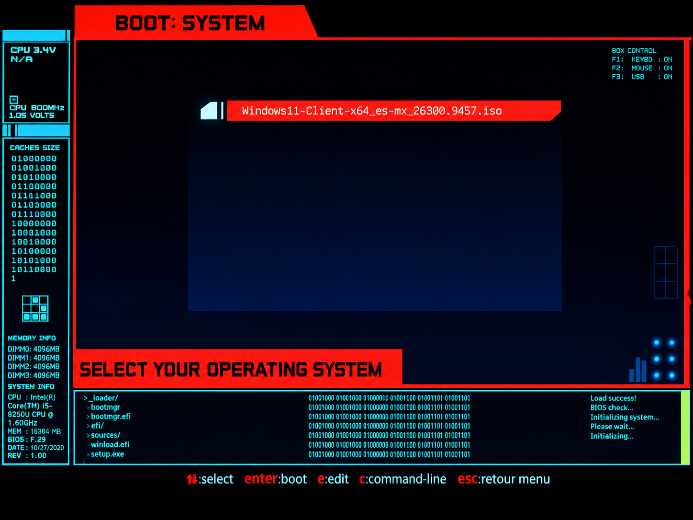

> [!NOTE]
> Esta guía instala en el equipo nuevo la imagen `.wim` creada en el [README-02](README-02.md).

> [!CAUTION]
> El proceso **borra todo el contenido del disco 0**.

## Qué necesita

Una USB preparada con [Ventoy](https://www.ventoy.net) que contenga, en las carpetas que prefiera:

- **ISO de Windows 11:** sirve para iniciar el equipo desde la USB.
- **`install.wim`:** la imagen creada en el README-02.
- [**`01.bat`**](../scripts/01.bat): formatea el disco e instala la imagen.

<br>

---

## Paso a paso

### 1. Iniciar desde la USB

Encienda el equipo, abra el menú de arranque y elija la USB. En el menú de Ventoy seleccione la ISO de Windows (modo **wimboot** si se le pide).

### 2. Abrir la ventana de comandos

Cuando aparezca el instalador de Windows, presione <kbd>Shift</kbd> + <kbd>F10</kbd>.

### 3. Ejecutar el script

Escriba la ruta de `01.bat` y presione <kbd>Enter</kbd>, por ejemplo:

```cmd
D:\automation\01.bat
```

> [!TIP]
> Si la USB no es `D:`, revise su letra con `diskpart` → `list volume`. La ruta de `install.wim` está en la primera línea del script.

El script formatea el disco, instala la imagen y configura el arranque. Al terminar muestra `LISTO. RETIRA LA USB Y REINICIA.`

> [!IMPORTANT]
> Espere ese mensaje. No apague el equipo mientras trabaja.

<!-- Imagen o video de la ejecución -->
<p align="center">
  
  
</p>

### 4. Crear el usuario

Retire la USB y reinicie. Continúe **sin internet** y cree el usuario del equipo (será administrador). Usted decide si lleva contraseña.

> [!TIP]
> Si no aparece *No tengo Internet*, presione <kbd>Shift</kbd> + <kbd>F10</kbd> y escriba `start ms-cxh:localonly`.

<br>

---

## Extra opcional: optimizar el equipo

[`optimizar.ps1`](../scripts/optimizar.ps1) deja Windows más limpio y rápido desde el primer día: quita aplicaciones innecesarias, desactiva servicios que no hacen falta, reduce anuncios y borra temporales. No toca Windows Update, Office ni los navegadores.

Abra **PowerShell como administrador** y ejecute:

```powershell
powershell -ExecutionPolicy Bypass -File E:\optimizar.ps1
```

> [!TIP]
> Cambie `E:` por la letra de la USB. El reporte queda en `C:\ProgramData\Setup\Reportes`.

<br>

---

**Anterior:** [Creación y captura de la imagen](README-02.md)