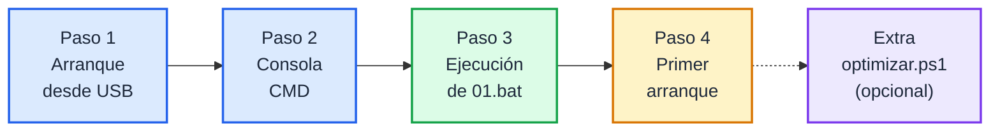

> [!NOTE]
> Esta guía aplica la imagen `.wim` generada en el [README-02](README-02.md) sobre el equipo destino. El despliegue completo se ejecuta con un único script desde una USB.

## Resumen

| | |
|---|---|
| **Herramientas** | Ventoy, DiskPart, DISM, BCDBoot |
| **Resultado** | Windows desplegado y listo para el primer arranque |
| **Beneficio** | Despliegue estandarizado y repetible en múltiples equipos |

> [!CAUTION]
> El proceso **formatea por completo el disco 0**. Debe usarse únicamente en equipos destinados a ser reinstalados.

## Flujo del procedimiento



<br>

---

## Requisitos

USB con [Ventoy](https://www.ventoy.net) que contenga los siguientes archivos, organizados en las carpetas que se prefiera:

| Archivo | Función |
|---|---|
| **ISO de Windows 11** | Entorno de arranque (instalador de Windows) |
| **`install.wim`** | Imagen generada en el README-02 |
| [**`01.bat`**](../scripts/01.bat) | Formatea el disco, aplica la imagen y configura el arranque |
| [**`optimizar.ps1`**](../scripts/optimizar.ps1) | *Opcional.* Optimización posterior al despliegue |

<br>

---

## Procedimiento

### 1. Arrancar desde la USB

Inicie el equipo desde la USB mediante el menú de arranque. En Ventoy seleccione la ISO de Windows (modo **wimboot** si se solicita).

<br>

### 2. Abrir la consola

Cuando cargue el instalador de Windows, presione <kbd>Shift</kbd> + <kbd>F10</kbd> para abrir una ventana de **CMD**.

<br>

### 3. Ejecutar el script

```cmd
D:\automation\01.bat
```

Reemplace la ruta según la ubicación del script en su USB. Si la letra de unidad es distinta, verifíquela con `diskpart` → `list volume`. La ruta de `install.wim` se define en la primera línea del script (variable `WIM`).

El script ejecuta en orden:

1. **Formateo de unidad:** particiona el disco 0 en GPT/UEFI (EFI, MSR y Windows).
2. **Aplicación de imagen:** aplica `install.wim` con DISM.
3. **Configuración del arranque:** habilita `BypassNRO` para continuar sin conexión y registra el arranque UEFI con BCDBoot.

Al finalizar muestra `LISTO. RETIRA LA USB Y REINICIA.` No interrumpa el proceso antes de ese mensaje.

<!-- Imagen o video de la ejecución -->
<p align="center">
  
  
</p>

<br>

### 4. Primer arranque

Retire la USB y reinicie. En la configuración inicial (OOBE) continúe sin conexión a internet y cree la cuenta local, que será administradora. La contraseña queda a criterio de quien realiza el despliegue.

Si la opción *No tengo Internet* no aparece, presione <kbd>Shift</kbd> + <kbd>F10</kbd> y ejecute `start ms-cxh:localonly`.

<br>
<br>

---

## Extra: optimización del equipo (opcional)

[`optimizar.ps1`](../scripts/optimizar.ps1) es un script de uso general, probado en producción en distintos entornos y equipos, con resultados positivos en despliegues masivos. Actúa sobre aplicaciones, servicios secundarios y ajustes de experiencia de usuario, sin modificar componentes centrales de Windows, por lo que está diseñado para no comprometer la estabilidad del sistema.

| Área | Qué aplica |
|---|---|
| **Aplicaciones** | Desinstala más de 50 aplicaciones innecesarias (*bloatware*): juegos, redes sociales, noticias, clima y servicios de Xbox |
| **Servicios** | Deshabilita 24 servicios secundarios sin uso en un entorno de trabajo y más de 15 tareas programadas de telemetría y diagnóstico |
| **Efectos visuales** | Desactiva animaciones y transparencias básicas, conservando el suavizado de fuentes y las miniaturas |
| **Privacidad y sugerencias** | Reduce publicidad, sugerencias y envío de datos de uso en Windows, Edge, Chrome, Brave y Office |
| **Energía y disco** | Plan Equilibrado, inicio rápido desactivado, limpieza de temporales y TRIM en unidades de estado sólido |

Los ajustes de usuario se aplican al perfil por defecto (*Default User*), por lo que **cada usuario nuevo los recibe en su primer inicio de sesión**; los perfiles ya existentes también se actualizan.

**Alcance:** no modifica Windows Update, Windows Defender ni los controladores, y tampoco Office, los navegadores instalados ni Microsoft Store. Antes de deshabilitar los servicios guarda un respaldo de su estado original.

**Ejecución:** desde PowerShell como administrador (reemplace `E:` por la letra de la USB):

```powershell
powershell -ExecutionPolicy Bypass -File E:\optimizar.ps1
```

El parámetro `-Fase` permite ejecutar solo una parte: `Config`, `Limpieza` o `Reporte` (solo lectura, sin cambios). Al finalizar se genera un reporte del equipo en `C:\ProgramData\Setup\Reportes`.

<br>

---

**Anterior:** [Creación y captura de la imagen](README-02.md)