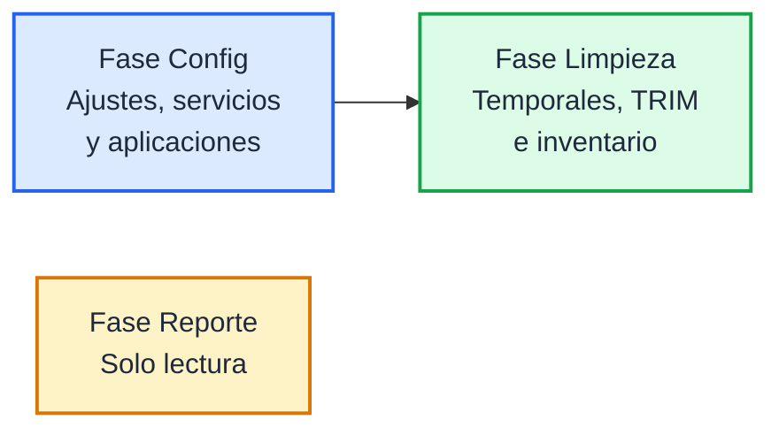

> [!NOTE]
> Este paso es **opcional**. Se ejecuta sobre el equipo ya desplegado con el [README-03](README-03.md) y no es necesario para que Windows funcione.

## Resumen

| | |
|---|---|
| **Herramienta** | [`optimizar.ps1`](../scripts/optimizar.ps1) (PowerShell) |
| **Resultado** | Equipo más ligero, con menos procesos y aplicaciones innecesarias desde el primer inicio de sesión |
| **Beneficio** | Una misma optimización, aplicada de forma uniforme en todos los equipos |
| **Resultado en producción** | Integrado en un flujo de alistamiento automatizado con el que se desplegaron 250 equipos en un mes, frente a una meta inicial de 40 mensuales |

`optimizar.ps1` es un script de uso general, probado en producción en distintos entornos y equipos, y utilizado en despliegues masivos. Actúa sobre aplicaciones, servicios secundarios y ajustes de experiencia de usuario, sin modificar componentes centrales de Windows, y está diseñado para minimizar el impacto sobre la estabilidad del sistema.

## Fases



Por defecto (`-Fase Todo`) se ejecutan Config y Limpieza una tras otra. `Reporte` solo genera el informe del equipo, sin realizar cambios.

<br>

---

## Qué aplica

| Área | Detalle |
|---|---|
| **Aplicaciones** | Desinstala más de 50 aplicaciones innecesarias (*bloatware*): juegos, redes sociales, noticias, clima y servicios de Xbox |
| **Servicios** | Deshabilita 24 servicios secundarios sin uso en un entorno de trabajo y más de 15 tareas programadas de telemetría y diagnóstico |
| **Efectos visuales** | Desactiva animaciones y transparencias básicas, conservando el suavizado de fuentes y las miniaturas |
| **Privacidad y sugerencias** | Reduce publicidad, sugerencias y envío de datos de uso en Windows, Edge, Chrome, Brave y Office |
| **Energía y disco** | Plan Equilibrado, inicio rápido desactivado, limpieza de temporales y TRIM en unidades de estado sólido |

Los ajustes de usuario se aplican al perfil por defecto (*Default User*), por lo que **cada usuario nuevo los recibe en su primer inicio de sesión**; los perfiles ya existentes también se actualizan.

## Alcance y seguridad

- **No modifica** Windows Update, Windows Defender ni los controladores, y tampoco Office, los navegadores instalados ni Microsoft Store.
- **Respaldo previo:** antes de deshabilitar los servicios guarda su estado original en `C:\ProgramData\Setup\Reportes`, lo que permite revertir el cambio.
- **Reporte:** al finalizar genera un informe del equipo en esa misma carpeta.

<br>

---

## Ejecución

Abra **PowerShell como administrador** y ejecute (reemplace `E:` por la letra de la USB):

```powershell
powershell -ExecutionPolicy Bypass -File E:\automation\optimizar.ps1
```

Para ejecutar solo una fase:

```powershell
powershell -ExecutionPolicy Bypass -File E:\automation\optimizar.ps1 -Fase Reporte
```

## Opciones configurables

Al inicio del script hay una sección de opciones (`$true` / `$false`) para adaptarlo a cada entorno:

| Opción | Por defecto | Función |
|---|---|---|
| `ResetPlanesEnergia` | `true` | Restaura los planes de energía y deja activo el plan Equilibrado |
| `QuitarAppx` | `true` | Desinstala las aplicaciones innecesarias |
| `QuitarBloatOEM` | `true` | Desinstala también las aplicaciones preinstaladas por el fabricante |
| `EfectosVisualesMinimos` | `true` | Desactiva animaciones y transparencias básicas |
| `ApagarRecall` | `true` | Desactiva Recall y Click to Do |
| `OptimizarWSL` | `true` | Si WSL está instalado, configura la liberación gradual de memoria |
| `DismLimpieza` | `false` | Ejecuta la limpieza del almacén de componentes (tarda varios minutos) |
| `QuitarDockerInicio` | `false` | Quita Docker Desktop del inicio automático |
| `DeshabilitarTelemetria` | `false` | Deshabilita además el servicio de telemetría `DiagTrack` |

<br>

---

**Anterior:** [Aplicación de la imagen](README-03.md)